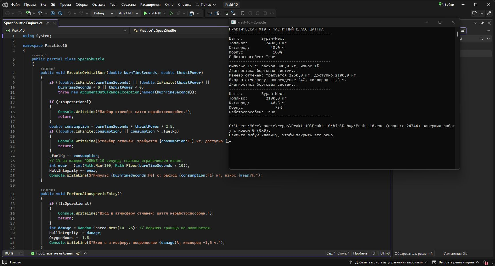

# Prakt-10 — Бортовой модуль космического шаттла

Практическая работа №10 «Частичные классы и методы в C#».

Консольная программа моделирует полёт шаттла «Буран-Next»: выводит телеметрию, рассчитывает расход топлива и износ корпуса, отменяет манёвр при нехватке топлива и выполняет диагностику. Класс SpaceShuttle разделён на три файла с помощью partial, а критические предупреждения выводятся частичным методом.

## Исходный код

### Program.cs

```csharp
using System;
using System.Globalization;
using System.Text;

namespace Practice10
{
    public class Program
    {
        public static void Main()
        {
            Console.OutputEncoding = Encoding.UTF8;
            CultureInfo.CurrentCulture = CultureInfo.GetCultureInfo("ru-RU");
            Console.WriteLine("ПРАКТИЧЕСКАЯ №10 • ЧАСТИЧНЫЙ КЛАСС ШАТТЛА");
            SpaceShuttle shuttle = new SpaceShuttle("Буран-Next", 2400.0, 48.0, 100);
            shuttle.PrintTelemetry();
            shuttle.ExecuteOrbitalBurn(15, 8.0);
            shuttle.CheckSystems();
            shuttle.ExecuteOrbitalBurn(60, 15.0);
            shuttle.PerformAtmosphericEntry();
            shuttle.CheckSystems();
            shuttle.PrintTelemetry();
        }
    }
}
```

### SpaceShuttle.Core.cs

```csharp
using System;

namespace Practice10
{
    public partial class SpaceShuttle
    {
        private double _fuelKg;
        private double _oxygenHours;
        private int _hullIntegrity;

        public string ShuttleName { get; set; }
        public double FuelKg
        {
            get { return _fuelKg; }
            set
            {
                if (!double.IsFinite(value)) throw new ArgumentOutOfRangeException(nameof(value));
                _fuelKg = Math.Max(0, value);
            }
        }

        public double OxygenHours
        {
            get { return _oxygenHours; }
            set
            {
                if (!double.IsFinite(value)) throw new ArgumentOutOfRangeException(nameof(value));
                _oxygenHours = Math.Max(0, value);
            }
        }

        public int HullIntegrity
        {
            get { return _hullIntegrity; }
            set { _hullIntegrity = Math.Clamp(value, 0, 100); }
        }

        public bool IsOperational => _hullIntegrity > 15 && _oxygenHours > 0;

        public SpaceShuttle(string name, double fuelKg, double oxygenHours, int hullIntegrity)
        {
            if (string.IsNullOrWhiteSpace(name)) throw new ArgumentException("Нужно имя.", nameof(name));
            this.ShuttleName = name;
            this.FuelKg = fuelKg;
            this.OxygenHours = oxygenHours;
            this.HullIntegrity = hullIntegrity;
        }
    }
}
```

### SpaceShuttle.Engines.cs

```csharp
using System;

namespace Practice10
{
    public partial class SpaceShuttle
    {
        public void ExecuteOrbitalBurn(double burnTimeSeconds, double thrustPower)
        {
            if (!double.IsFinite(burnTimeSeconds) || !double.IsFinite(thrustPower) ||
                burnTimeSeconds < 0 || thrustPower < 0)
                throw new ArgumentOutOfRangeException(nameof(burnTimeSeconds));

            if (!IsOperational)
            {
                Console.WriteLine("Манёвр отменён: шаттл неработоспособен.");
                return;
            }
            double consumption = burnTimeSeconds * thrustPower * 2.5;
            if (!double.IsFinite(consumption) || consumption > _fuelKg)
            {
                Console.WriteLine($"Манёвр отменён: требуется {consumption:F1} кг, доступно {_fuelKg:F1} кг.");
                return;
            }
            _fuelKg -= consumption;
            // 1% за каждые ПОЛНЫЕ 10 секунд; сначала ограничиваем износ.
            int wear = (int)Math.Min(100, Math.Floor(burnTimeSeconds / 10));
            HullIntegrity -= wear;
            Console.WriteLine($"Импульс {burnTimeSeconds:F0} с: расход {consumption:F1} кг, износ {wear}%.");
        }

        public void PerformAtmosphericEntry()
        {
            if (!IsOperational)
            {
                Console.WriteLine("Вход в атмосферу отменён: шаттл неработоспособен.");
                return;
            }
            int damage = Random.Shared.Next(10, 26); // Верхняя граница не включается.
            HullIntegrity -= damage;
            OxygenHours -= 1.5;
            Console.WriteLine($"Вход в атмосферу: повреждение {damage}%, кислород -1,5 ч.");
        }
    }
}
```

### SpaceShuttle.Diagnostics.cs

```csharp
using System;

namespace Practice10
{
    public partial class SpaceShuttle
    {
        // По условию и объявление, и реализация находятся в Diagnostics.cs.
        partial void OnCriticalSystemAlert(string systemName, string message);

        partial void OnCriticalSystemAlert(string systemName, string message)
        {
            ConsoleColor previous = Console.ForegroundColor;
            if (!Console.IsOutputRedirected) Console.ForegroundColor = ConsoleColor.Red;
            Console.WriteLine($"[ТРЕВОГА БК] {systemName}: {message}");
            if (!Console.IsOutputRedirected) Console.ForegroundColor = previous;
        }

        public void CheckSystems()
        {
            Console.WriteLine("Диагностика бортовых систем...");
            if (_fuelKg < 500)
                OnCriticalSystemAlert("Топливная система", "Критический остаток топлива!");
            if (_hullIntegrity < 25)
                OnCriticalSystemAlert("Контур обшивки", "Опасность разрушения корпуса!");
            if (_oxygenHours <= 0)
                OnCriticalSystemAlert("Жизнеобеспечение", "Запас кислорода исчерпан!");
        }

        public void PrintTelemetry()
        {
            Console.WriteLine("--------------------------------------------");
            Console.WriteLine($"Шаттл:        {ShuttleName}");
            Console.WriteLine($"Топливо:      {_fuelKg,8:F1} кг");
            Console.WriteLine($"Кислород:     {_oxygenHours,8:F1} ч");
            Console.WriteLine($"Корпус:       {_hullIntegrity,8}%");
            Console.WriteLine($"Работоспособен: {IsOperational}");
            Console.WriteLine("--------------------------------------------");
        }
    }
}
```

## Скриншоты работы программы

### Скриншот 1



